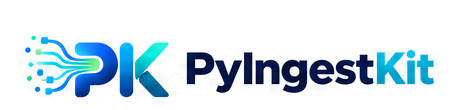

<p align="center">
  <picture>
    <source media="(prefers-color-scheme: dark)" srcset="docs/assets/brand/pyingestkit-primary-lockup-dark.png">
    <source media="(prefers-color-scheme: light)" srcset="docs/assets/brand/pyingestkit-primary-lockup-light.png">
    
  </picture>
</p>

<p align="center">
  <strong>From any source to reliable datasets.</strong><br>
  <code>Acquire</code> &nbsp;→&nbsp; <code>Preserve RAW</code> &nbsp;→&nbsp; <code>Validate</code> &nbsp;→&nbsp; <code>Publish</code>
</p>

<p align="center">
  <a href="https://github.com/tawounfouet/pyingestkit/actions/workflows/ci.yml"></a>
  <a href="https://github.com/tawounfouet/pyingestkit/actions/workflows/security.yml"></a>
  <a href="https://pypi.org/project/pyingestkit/"></a>
  <a href="https://www.python.org/"></a>
  <a href="LICENSE"></a>
  <a href="https://tawounfouet.github.io/pyingestkit/"></a>
</p>

---

**PyIngestKit** is a lightweight, composable Python framework for reliable, traceable and replayable batch ingestion.

It focuses strictly on **how to ingest data reliably** — preserving durable RAW acquisition evidence, producing immutable content-addressed dataset versions, and enforcing atomic compare-and-swap (CAS) publications with zero accidental overwrites.

> External orchestrators (Airflow, Dagster, Prefect) decide **when to run**. PyIngestKit guarantees **how it runs safely**.

---

## ⚡ Highlights

- 🛡️ **Governed CAS Publication** — Atomic compare-and-swap with durable ledgers (PostgreSQL / Memory), retention holds, guarded GC, and governed rollback.
- 📦 **Zero-Bloat Core** — Pure standard library core by default. Heavy connectors (`psycopg`, `boto3`, `httpx`, `pyarrow`) are strictly opt-in extras.
- 🔄 **Strict Deterministic Replay** — Replay runs from verified historical RAW artifacts; never silently re-fetches live external sources.
- 🩺 **Built-in CLI & Self-Diagnostics** — Standardized `pik` command line with instant environment health check via `pik doctor`.

---

## 🚀 Quickstart (30 seconds)

### 1. Installation

```bash
# Base framework (zero heavy dependencies)
pip install pyingestkit

# Or with specific providers
pip install "pyingestkit[postgres,s3,http]"
```

### 2. Run an Ingestion Pipeline

```python
from pathlib import Path
from pyingestkit import IngestionDefinition, IngestionRuntime, Source
from pyingestkit.adapters.filesystem import FileArtifactStore, FileSourceConnector
from pyingestkit.application.decoders import DecoderRegistry
from pyingestkit.application.sources import SourceRegistry
from pyingestkit.decoders import CsvDecoder
from pyingestkit.stores import FileDatasetVersionStore

root = Path("./.pyingest")

runtime = IngestionRuntime(
    sources=SourceRegistry([FileSourceConnector()]),
    decoders=DecoderRegistry([CsvDecoder()]),
    artifacts=FileArtifactStore(root=root / "artifacts"),
    versions=FileDatasetVersionStore(root=root / "datasets"),
)

result = runtime.run(
    IngestionDefinition(
        name="customers_pipeline",
        source=Source.file(path="./data/customers.csv"),
        decoder="csv",
        dataset="customers",
    )
)

print(f"Status: {result.status.value} | Version: {result.version_id}")
```

---

## 🛠️ CLI: `pik`

PyIngestKit includes a fast CLI with zero runtime overhead on startup:

```bash
# Run system and environment diagnostics
pik doctor

# Inspect environment in JSON format
pik doctor --json
```

---

## 🧩 Providers & Optional Extras

| Extra | Capabilities | Drivers Installed |
| :--- | :--- | :--- |
| `pyingestkit` *(base)* | Core runtime, Filesystem, Memory, CSV, JSON(L) | Standard library |
| `pyingestkit[http]` | Robust HTTP(S) acquisition with retry policies | `httpx` |
| `pyingestkit[postgres]`| PostgreSQL targets, staging & publication ledger | `psycopg`, `sqlalchemy` |
| `pyingestkit[s3]` | S3 / MinIO / Ceph / R2 object storage artifacts | `boto3` |
| `pyingestkit[parquet]` | High-performance Parquet format decoder | `pyarrow` |
| `pyingestkit[excel]` | Excel `.xlsx` / `.xls` spreadsheets decoding | `openpyxl` |

---

## 📚 Documentation & Resources

- 📖 **Official Documentation :** [https://tawounfouet.github.io/pyingestkit/](https://tawounfouet.github.io/pyingestkit/)
- 🏛️ **Architecture & RFC-001 :** [RFC-001 Publication & Lifecycle Governance](docs/rfc/RFC-001-publication-lifecycle-governance.md)
- 🚀 **Migration Guide (V1 → V2) :** [Migration Guide](docs/guides/migrate-v1-to-v2.md)
- 📝 **Changelog & Releases :** [Release Notes](docs/releases/v2.1.0.md)

---

## 📄 License

Distributed under the [MIT License](LICENSE).
