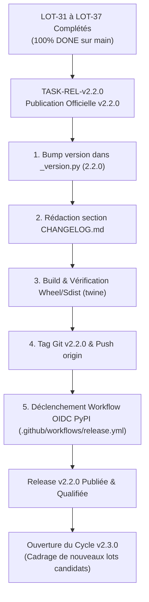

# Analyse Stratégique & Arbitrage : Publication de la Release v2.2.0 vs Poursuite du Flux de Développement

- **Date :** 2026-10-25
- **Auteur :** Antigravity / Thomas Awounfouet
- **Contexte :** Décision d'arbitrage de cycle de livraison suite à la complétion intégrale des LOT-31 à LOT-37
- **Références amont :**  
  - [`docs/build/tasks/TODOS.md`](../build/tasks/TODOS.md)
  - [`docs/build/backlog/README.md`](../build/backlog/README.md)
  - [`docs/roadmap/post-2.0-scope-review.md`](../roadmap/post-2.0-scope-review.md)
  - [`../../integrations/gmail-ingestion/docs/releases/v0.3.0.md`](../../../integrations/gmail-ingestion/docs/releases/v0.3.0.md)

---

## 1. Contexte & Problématique

Depuis la publication de la version stable **`2.1.0`** le 4 octobre 2026, sept jalons de développement consécutifs (`LOT-31` à `LOT-37`) ont été intégralement cadrés, implémentés, testés et fusionnés sur la branche `main` de `PyIngestKit`.

Tous les items initialement inscrits au backlog opérationnel (`ITEM-001` à `ITEM-007`) sont aujourd'hui au statut `DONE`.

Une question stratégique de gouvernance se pose :
> **Faut-il ouvrir immédiatement le cadrage d'un nouveau lot candidat (ex: connecteur cible S3/R2 partitionné, extensions Parquet/Avro, profilage) ou marquer un arrêt méthodologique pour qualifier, sceller et publier la release officielle `v2.2.0` ?**

---

## 2. Bilan de l'Accumulation Technique depuis la v2.1.0

Le volume d'innovations cumulé sur la branche `main` sans release officielle est exceptionnellement dense :

| Jalon | Item Backlog | Domaine Impacté | Apports Majeurs | Risque en Cas de Non-Release Immédiate |
| :--- | :--- | :--- | :--- | :--- |
| **LOT-31** | `ITEM-001` | CLI (`pik`) | Bootstrap stdlib, exit codes normalisés (`IntEnum`), diagnostic `pik doctor`, isolation filesystem. | Les utilisateurs restent contraints d'utiliser l'API programmatique sans bénéficier du CLI stabilisé. |
| **LOT-32** | `ITEM-002` | Racine Repo | Assainissement racine, isolation de la stack `infra/`, profils d'exécution unifiés. | Divergence de configuration entre environnement de test local et paquet distribué. |
| **LOT-33** | `ITEM-003` | Design & Brand | Intégration des brand assets officiels, tokens CSS, logos vectoriels et documentation enrichie. | Documentation et site MkDocs déconnectés de la version publiée sur PyPI. |
| **LOT-34** | `ITEM-004` | Supply Chain | Workflow GitHub Actions OIDC (`release.yml`), attestation cryptographique de provenance Sigstore/SLSA. | Le pipeline d'automatisation de release n'est jamais éprouvé en conditions réelles. |
| **LOT-35** | `ITEM-005` | Core Replay | Traçabilité fine du Replay historique (`StrictReplaySession`, `reconstructed_run_id`, chaînage `PARENT_RUN_ID`). | Absence de traçabilité d'audit officielle pour les utilisateurs externes. |
| **LOT-36** | `ITEM-006` | Postgres Target | Staging Table Pattern transactionnel (`ON COMMIT DROP`), `COPY FROM STDIN` streaming, modes `UPSERT`/`MERGE`, saut d'idempotence. | Les flux d'ingestion data warehouse restent limités aux modes destructifs (APPEND/REPLACE). |
| **LOT-37** | `ITEM-007` | HTTP Source | Bouclier anti-SSRF stdlib, immunité DNS Rebinding par ancrage socket, OAuth 2.0 avec rotation transparente, requêtes `POST`/`PUT` avec payloads. | Les flux d'ingestion API SaaS restent exposés aux failles de sécurité SSRF et sans support OAuth2. |

---

## 3. Analyse Détaillée des Options Stratégiques

### Option A : Continuer le flux de développement de nouveaux lots (LOT-38+)
- **Principe :** Enchaîner directement sur l'instruction d'un prochain lot technique sans incrémenter de version ni publier sur PyPI.
- **Avantages perçus :**
  - Inertie de développement maintenue (pas de pause administrative pour packager et tagguer).
  - Possibilité de regrouper encore plus de fonctionnalités dans une future "grosse" release.
- **Inconvénients majeurs & Risques :**
  - **Dette de qualification croissante :** Plus le périmètre non publié grandit, plus le diagnostic d'une régression éventuelle devient complexe.
  - **Obsolescence de la version PyPI :** La version publique `2.1.0` ne reflète plus l'état de l'art du moteur, privant les projets clients (ex: `gmail-ingestion`, `cogniflow-platform`) des correctifs de sécurité SSRF et du support UPSERT.
  - **Violation du principe de livraison continue :** Empiler du code sur `main` sans livraison contredit les standards de l'artisanat logiciel moderne (*Release early, release often*).

### Option B : Cristalliser, qualifier et publier la version officielle `v2.2.0` (Recommandée)
- **Principe :** Geler temporairement l'ajout de nouvelles fonctionnalités, exécuter la procédure de release officielle, valider le packaging wheel/sdist, publier via OIDC sur PyPI et mettre à jour la documentation.
- **Avantages :**
  - **Consolidation d'un jalon de production :** Les apports majeurs des LOT-31 à LOT-37 sont scellés et immédiatement consommables.
  - **Validation de bout en bout du workflow OIDC :** Le pipeline automatisé conçu au LOT-34 est éprouvé sur un tag Git réel.
  - **Repartir sur des bases saines :** Le prochain cycle (`v2.3.0`) démarrera sur un `main` propre, taggué et synchronisé avec PyPI.
- **Inconvénients / Coût :**
  - Nécessite une session dédiée pour la mise à jour du `CHANGELOG.md`, le bump de `_version.py`, et le suivi du déploiement. (Ce coût est très faible, estimé à ~15-20 minutes).

---

## 4. Benchmark avec les Pratiques du Monorepo

Dans les projets adjacents du monorepo (notamment `integrations/gmail-ingestion` récemment synchronisé) :
- Les versions font l'objet de jalons formalisés (`v0.1.0` -> `v0.2.0` -> `v0.3.0`).
- Chaque version dispose de sa documentation de release (`docs/releases/v0.3.0.md`), de qualification (`docs/releases/v0.3.0-qualification.md`) et de compatibilité (`docs/releases/COMPATIBILITY-v0.3.0.md`).
- Les fonctionnalités ne sont jamais accumulées indéfiniment sans formalisation d'une version scellée.

PyIngestKit, en tant que package socle, doit maintenir un niveau de rigueur de release au moins égal ou supérieur.

---

## 5. Réponse à la Question de Gouvernance : La Release Nécessite-t-elle un Item de Backlog ?

La réponse méthodologique est **NON** :
1. **Rôle d'un Item de Backlog (`ITEM-xxx`) :**
   Un item de backlog est une **expression de besoin** fonctionnel, architectural ou de dette technique brute (ex: *« Besoin d'un mécanisme d'UPSERT pour PostgreSQL »*). Il sert à motiver l'ouverture d'un chantier d'ingénierie et donne lieu à un lot de conception/développement.
2. **Rôle d'une Release (`v2.2.0`) :**
   La release n'est pas un nouveau besoin fonctionnel : c'est l'acte de **publication et de consolidation** des items de backlog qui ont déjà été livrés et clôturés (`ITEM-001` à `ITEM-007`).
3. **Articulation avec les Tâches :**
   En revanche, la release requiert une **fiche de tâche opérationnelle** (`docs/build/tasks/TASK-REL-v2.2.0_stable-release-publication.md`) enregistrée dans `TODOS.md` pour garantir que chaque geste (bump SemVer, build wheel, validation twine, tag Git, publication OIDC, qualification post-déploiement) soit tracé et vérifié.

---

## 6. Diagramme de la Transition Opérationnelle



```text
┌────────────────────────────────────────────────────────┐
│ LOT-31 à LOT-37 Intégralement Livrés & Fusionnés       │
│ (100 % des tâches DONE, main à jour)                   │
└───────────────────────────┬────────────────────────────┘
                            │
                            ▼
┌────────────────────────────────────────────────────────┐
│ TASK-REL-v2.2.0 : Publication Officielle v2.2.0        │
├────────────────────────────────────────────────────────┤
│ 1. Bump version : _version.py -> '2.2.0'               │
│ 2. Changelog : Rédaction section [2.2.0]               │
│ 3. Packaging : python -m build && twine check          │
│ 4. Git : Commit de release + Tag annoté v2.2.0         │
│ 5. CI/CD : Déclenchement automatique workflow OIDC    │
└───────────────────────────┬────────────────────────────┘
                            │
                            ▼
┌────────────────────────────────────────────────────────┐
│ Release v2.2.0 Officiellement Publiée sur PyPI        │
└───────────────────────────┬────────────────────────────┘
                            │
                            ▼
┌────────────────────────────────────────────────────────┐
│ Ouverture du Cycle v2.3.0                              │
│ Cadrage et instruction de nouveaux lots candidats     │
└────────────────────────────────────────────────────────┘
```

---

## 7. Décision Retenue & Prochaines Actions

1. **Option Retenue :** **Option B (Publication Immédiate de la Release v2.2.0)**.
2. **Création de la tâche dédiée :** Créer la fiche de tâche opérationnelle `docs/build/tasks/TASK-REL-v2.2.0_stable-release-publication.md`.
3. **Mise à jour du registre :** Enregistrer la tâche dans `docs/build/tasks/TODOS.md`.
4. **Exécution de la release :** Réaliser le bump de version, le changelog, le tag Git et la publication PyPI OIDC.
