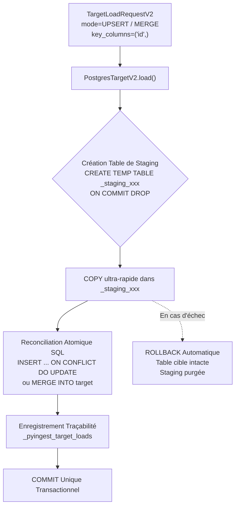

# Exploration Technique & Cadrage : LOT-36 (PostgreSQL UPSERT, MERGE & Staging Transactionnel)

- **Date :** 2026-10-25
- **Auteur :** Antigravity / Pair Programming
- **Item Backlog :** [`docs/build/backlog/ITEM-006_postgresql-target-upsert-merge-and-staging.md`](../../build/backlog/ITEM-006_postgresql-target-upsert-merge-and-staging.md)
- **Document Source :** [`docs/roadmap/post-2.0-scope-review.md`](../../roadmap/post-2.0-scope-review.md) (Section 3.3)
- **LOT Cible :** LOT-36 (v2.2.0)
- **Statut :** VALIDÉ (passé en analyse détaillée et plan d'implémentation)
- **Documents aval :**
  - Analyse d'architecture : [`docs/analyses/2026-10-25_postgres-upsert-merge-and-staging-analysis.md`](../2026-10-25_postgres-upsert-merge-and-staging-analysis.md)
  - Plan de réalisation : [`docs/build/plans/2026-10-25_plan-postgres-upsert-merge-and-staging.md`](../../build/plans/2026-10-25_plan-postgres-upsert-merge-and-staging.md)
  - Tâche opérationnelle : [`docs/build/tasks/TASK-LOT36-01_postgres-upsert-merge-and-staging.md`](../../build/tasks/TASK-LOT36-01_postgres-upsert-merge-and-staging.md)

Le LOT-36 (issu de l'item de backlog `ITEM-006`) vise à hisser l'adaptateur cible PostgreSQL (`PostgresTargetV2`) au niveau des exigences de production d'un Lakehouse / Data Warehouse d'entreprise.

---

## 1. Contexte & Problématique Actuelle

Dans PyIngestKit V2 (stabilisé au LOT-14), `PostgresTargetV2` propose 3 modes :
- `APPEND` : Conservation des lignes existantes + `COPY FROM STDIN`.
- `TRUNCATE_LOAD` : `TRUNCATE TABLE` + `COPY FROM STDIN`.
- `REPLACE` : `DELETE FROM table` + `COPY FROM STDIN`.

### Les limites constatées en production :
1. **Absence d'UPSERT incrémental :** Si un flux de données contient des mises à jour de données existantes (par ex. changement de statut d'une commande ou mise à jour de profil client), `APPEND` provoque des doublons ou viole les contraintes d'unicité / clés primaires.
2. **Contrainte technique de `COPY` sous PostgreSQL :** La commande `COPY ... FROM STDIN` est le moyen le plus rapide d'écrire des millions de lignes dans PostgreSQL, mais le protocole `COPY` ne supporte pas nativement la clause `ON CONFLICT DO UPDATE`.
3. **Risque de corruption lors de re-jeu partiel :** En cas d'interruption réseau ou de crash, si un chargement `APPEND` échoue à mi-parcours ou est rejoué, il n'existe pas de mécanisme automatique pour vérifier si le dataset versionné a déjà été injecté dans la table de destination.

---

## 2. Architecture Cible Proposée pour le LOT-36



```text
┌────────────────────────────────────────────────────────┐
│ TargetLoadRequestV2                                    │
│ mode = UPSERT / MERGE, key_columns = ('id',)           │
└───────────────────────────┬────────────────────────────┘
                            │
                            ▼
┌────────────────────────────────────────────────────────┐
│ PostgresTargetV2.load()                                │
└───────────────────────────┬────────────────────────────┘
                            │
                            ▼
┌────────────────────────────────────────────────────────┐
│ Création Table de Staging                              │
│ CREATE TEMP TABLE _staging_xxx ON COMMIT DROP          │
└───────────────────────────┬────────────────────────────┘
                            │
                            ▼
┌────────────────────────────────────────────────────────┐
│ COPY ultra-rapide dans _staging_xxx                    │
└─────────────┬────────────────────────────┬─────────────┘
              │ (Succès)                   │ (En cas d'échec)
              ▼                            ▼
┌──────────────────────────────────┐ ┌──────────────────────────────────┐
│ Réconciliation Atomique SQL      │ │ ROLLBACK Automatique             │
│ INSERT ... ON CONFLICT DO UPDATE │ │ Table cible intacte,             │
│ ou MERGE INTO target             │ │ Staging table purgée             │
└─────────────┬────────────────────┘ └──────────────────────────────────┘
              │
              ▼
┌──────────────────────────────────┐
│ Enregistrement Traçabilité       │
│ Table _pyingest_target_loads     │
└─────────────┬────────────────────┘
              │
              ▼
┌──────────────────────────────────┐
│ COMMIT Unique Transactionnel     │
└──────────────────────────────────┘
```

### A. Extension du Domaine Cible (`pyingestkit.domain.targets`)
- **Nouveaux Modes dans `TargetLoadModeV2` :**
  - `UPSERT = "upsert"` : Insertion avec mise à jour conditionnelle si conflit sur la clé (`INSERT INTO target SELECT * FROM staging ON CONFLICT (keys) DO UPDATE SET ...`).
  - `MERGE = "merge"` : Synchronisation bidirectionnelle (INSERT les nouveaux, UPDATE les existants, et optionnellement DELETE / FLAG les orphelins).
- **Enrichissement de `TargetLoadRequestV2` :**
  - `key_columns: tuple[str, ...] = ()` : Colonnes identifiant l'unicité métier (clés primaires ou contraintes d'unicité).
  - `update_columns: tuple[str, ...] = ()` : Colonnes cibles à écraser lors d'un conflit (si omis, met à jour toutes les colonnes hors clés).
  - `idempotent: bool = False` : Contrôle d'idempotence préventif.

### B. Pattern de Table de Staging Transactionnelle (`PostgresTargetV2`)
Au sein de la même transaction SQLAlchemy/psycopg :
1. **Création dynamique d'une table temporaire :**
   ```sql
   CREATE TEMP TABLE _stg_orders (LIKE public.orders INCLUDING DEFAULTS) ON COMMIT DROP;
   ```
2. **Chargement de masse à haute vitesse :** `COPY _stg_orders (...) FROM STDIN` via le protocole binaire/texte psycopg.
3. **Réconciliation SQL atomique selon le mode :**
   - Pour `UPSERT` :
     ```sql
     INSERT INTO public.orders (id, customer_id, amount, updated_at)
     SELECT id, customer_id, amount, updated_at FROM _stg_orders
     ON CONFLICT (id) DO UPDATE SET
       customer_id = EXCLUDED.customer_id,
       amount = EXCLUDED.amount,
       updated_at = EXCLUDED.updated_at;
     ```
   - Pour `MERGE` : Compatible PostgreSQL 15+ (`MERGE INTO target USING staging ...`) ou fallback CTE pour PostgreSQL 13/14.

### C. Traçabilité & Idempotence (`_pyingest_target_loads`)
Table technique créée automatiquement si absente :
- `load_id` (UUID)
- `target_id` (identifiant logique de la cible)
- `destination` (`schema.table`)
- `dataset_id` & `dataset_version_id` (empreinte SHA-256 du dataset)
- `mode` (`append`, `upsert`, `merge`, `replace`, etc.)
- `rows_loaded`
- `status` (`succeeded`, `failed`, `rolled_back`)
- `started_at` & `completed_at`

Permet d'ajouter une option `idempotent=True` dans `TargetLoadRequestV2` : si un chargement de la même version de dataset a déjà réussi sur la même table avec le même mode, le chargement peut être sauté sans ré-injection redondante.

---

## 3. Garde-fous & Invariants d'Architecture

1. **Découplage Hexagonal Strict :**
   - `domain/targets` et `ports/targets.py` ne doivent jamais importer psycopg ni sqlalchemy (gardé par `tests/architecture/test_v2_postgres_target_boundary.py`).
   - `TargetLoadRequestV2` ne contient que des types de données purs (tuples de chaînes pour les clés).
2. **Neutralité de l'API Publique :**
   - `from pyingestkit import ...` reste gelé à ses 11 symboles initiaux.
   - Le namespace racine de cibles `pyingestkit.targets` reste neutre vis-à-vis des providers.
   - `PostgresTargetV2` reste accessible via `pyingestkit.targets.v2` et `pyingestkit.adapters.postgres`.
3. **Transactionnalité Unitaire :**
   - Tout le cycle (création staging + COPY + réconciliation + écriture dans `_pyingest_target_loads`) s'exécute dans un seul bloc `with engine.begin()`. Tout échec déclenche un ROLLBACK total.

---

## 4. Découpage du Lot Prévu

| Phase | Livrable | Fichiers Impactés |
| :--- | :--- | :--- |
| **1. Analyse & Plan** | Analyse d'architecture & Plan de lot | `docs/analyses/` & `docs/build/plans/` |
| **2. Tâche & Backlog** | Activation de la tâche | `docs/build/tasks/TASK-LOT36-01_...` & `TODOS.md` |
| **3. Domaine & Modèles** | Modes `UPSERT` / `MERGE`, clés dans `TargetLoadRequestV2` | `src/pyingestkit/domain/targets/models.py` |
| **4. Adaptateur Postgres** | Staging table + requêtes de réconciliation SQL | `src/pyingestkit/adapters/postgres/target.py` |
| **5. Traçabilité** | Table de métadonnées `_pyingest_target_loads` | `src/pyingestkit/adapters/postgres/target.py` |
| **6. Validation & Tests** | Tests unitaires & intégration PostgreSQL | `tests/unit/v2/test_postgres_target_v2.py`, etc. |
| **7. Clôture** | REX, revue formelle, PR et merge | `docs/build/feedback/`, `docs/build/reviews/` |

---

## 5. Points de Cadrage & Décisions Retenues

1. **Périmètre du MERGE :**
   - Implémenter directement `UPSERT` (via `ON CONFLICT DO UPDATE` / `DO NOTHING`) et `MERGE` (syntaxe native PG15+ avec fallback CTE si nécessaire).
2. **Comportement de l'Idempotence :**
   - Optionnel via le flag `idempotent: bool = False` sur `TargetLoadRequestV2`. Si `True`, vérification dans `_pyingest_target_loads` et court-circuit sécurisé si déjà matérialisé.
