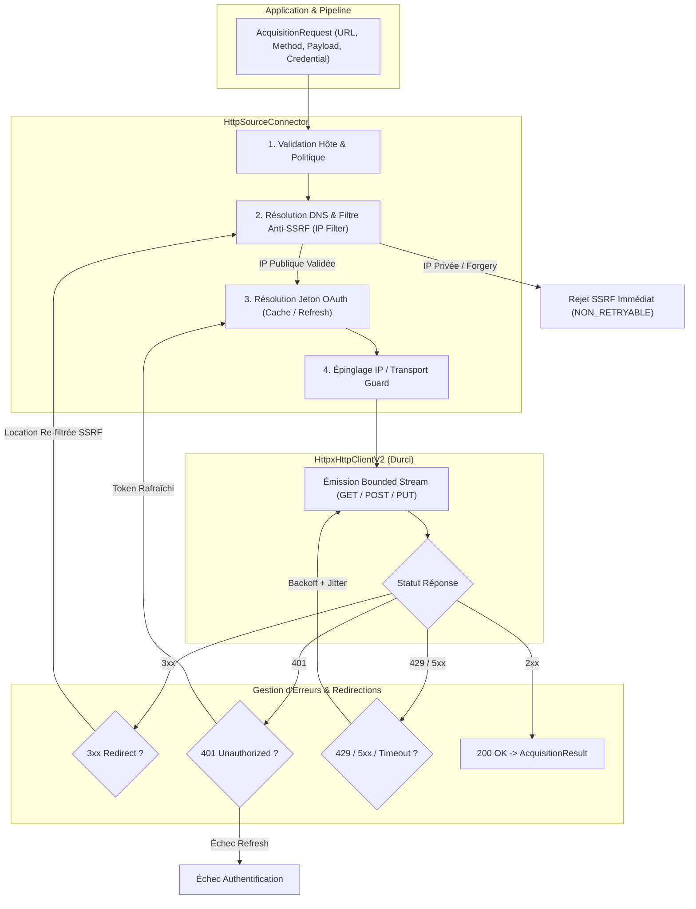

# Exploration Technique & Cadrage : LOT-37 (Acquisition HTTP Avancée, Rafraîchissement OAuth & Durcissement SSRF)

- **Date :** 2026-10-25
- **Auteur :** Antigravity / Pair Programming
- **Item Backlog :** [`docs/build/backlog/ITEM-007_advanced-http-acquisition-and-ssrf-hardening.md`](../../build/backlog/ITEM-007_advanced-http-acquisition-and-ssrf-hardening.md)
- **Document Source :** [`docs/roadmap/post-2.0-scope-review.md`](../../roadmap/post-2.0-scope-review.md) (Section 3.4)
- **LOT Cible :** LOT-37 (v2.3.0)
- **Statut :** VALIDÉ
- **Documents aval :**
  - Analyse d'architecture : [`docs/analyses/2026-10-25_advanced-http-acquisition-and-ssrf-hardening-analysis.md`](../)
  - Plan de réalisation : [`docs/build/plans/2026-10-25_plan-advanced-http-acquisition-and-ssrf-hardening.md`](../../build/plans/)
  - Tâche opérationnelle : [`docs/build/tasks/TASK-LOT37-01_advanced-http-acquisition-and-ssrf-hardening.md`](../../build/tasks/)

---

## 1. Contexte & Problématique Actuelle

Dans PyIngestKit V2 (stabilisé au LOT-14 et consolidé au LOT-36), le connecteur source HTTP (`HttpSourceConnector`) situé dans `src/pyingestkit/adapters/http/source.py` offre une passerelle réseau bornée et sécurisée reposant sur `HttpClientV2` et son implémentation HTTPX (`HttpxHttpClientV2`).

Bien qu'efficace pour des téléchargements simples de fichiers ou d'APIs publiques directes, l'expérience opérationnelle sur des intégrations d'API SaaS d'entreprise (ex: Salesforce, Stripe, HubSpot, Google Cloud, Workday) met en lumière plusieurs limitations critiques :

### Limites constatées en production :

1. **Absence de méthodes d'écriture et de payloads (`POST`, `PUT`) :**
   - L'adaptateur `HttpxHttpClientV2` code en dur l'instruction `self._client.stream("GET", ...)` et `HttpRequestV2` n'accepte ni verbe HTTP ni corps de requête.
   - De nombreuses API d'interrogation SaaS (ex: Stripe Search API, Salesforce Bulk Query, GraphQL, Elasticsearch) requièrent obligatoirement une requête `POST` avec un corps JSON pour transmettre les filtres et les curseurs de pagination complexes.

2. **Absence de gestion du cycle de vie des jetons OAuth 2.0 :**
   - Le composant `HttpCredentialResolverV2` actuel résout statiquement des identifiants en en-têtes HTTP figés (`Authorization: Bearer <token>`).
   - Si le jeton d'accès expire en cours de pipeline (réponse `401 Unauthorized`), l'acquisition échoue irrémédiablement (`acquisition.http.status_401`), stoppant brutalement les flux batch longs sans tentative de renouvellement via un `refresh_token` ou un flux `client_credentials`.

3. **Vulnérabilités SSRF (*Server-Side Request Forgery*) & Risque de DNS Rebinding :**
   - La validation actuelle `HttpAccessPolicy` vérifie uniquement la conformité textuelle du nom d'hôte (`host in self.allowed_hosts`).
   - Si un nom de domaine autorisé ou dynamique résout vers une adresse IP interne (ex: réseau privé RFC 1918 `10.0.0.0/8`, `172.16.0.0/12`, `192.168.0.0/16`, interface loopback `127.0.0.1`, ou l'adresse critique de métadonnées cloud `169.254.169.254`), la requête est émise, exposant les secrets d'infrastructure cloud.
   - Une attaque par **DNS Rebinding** (où le serveur DNS renvoie une IP publique lors de la validation initiale puis une IP privée au moment de la connexion TCP) ou une redirection HTTP intermédiaire (`302 Found` vers `http://169.254.169.254/computeMetadata/v1/`) contournerait les contrôles actuels.

4. **Retry naïf et absence de gestion d'incertitude réseau (`OutcomeUncertainty`) :**
   - Le mécanisme de retry actuel applique un backoff purement exponentiel sans gigue (*jitter*), augmentant le risque de tempête de requêtes synchronisées (*thundering herd*).
   - Lors de requêtes `POST`, une perte de connexion après l'envoi de la requête laisse le système dans un état incertain (`OutcomeUncertainty.UNCERTAIN`) qu'il faut signaler formellement dans `FailureEvidence` pour empêcher des réémissions en double non idempotentes.

---

## 2. Architecture Cible Proposée

Le LOT-37 introduit une couche de transport et d'acquisition HTTP durcie au niveau bancaire et télécom, tout en préservant l'isolation hexagonale et la neutralité de l'API publique.



```text
┌────────────────────────────────────────────────────────────────────────┐
│                      AcquisitionRequest (V2)                           │
│     (URL, Méthode: GET/POST/PUT, Payload optionnel, CredentialRef)     │
└───────────────────────────────────┬────────────────────────────────────┘
                                    │
                                    ▼
┌────────────────────────────────────────────────────────────────────────┐
│                        HttpSourceConnector                             │
│  1. Validation Hôte & Port autorisés (HttpAccessPolicy)                │
│  2. Résolution DNS & Validation Anti-SSRF (AntiSsrfValidator)          │
│     ├── Blocage Loopback (127.0.0.0/8, ::1)                            │
│     ├── Blocage RFC 1918 (10.0.0.0/8, 172.16.0.0/12, 192.168.0.0/16)    │
│     ├── Blocage Link-Local & Cloud Metadata (169.254.169.254, fe80::) │
│     └── Épinglage d'IP pour contrer le DNS Rebinding                   │
│  3. Résolution OAuth 2.0 (OAuthTokenManager : Token Cache & Expiry)   │
└───────────────────────────────────┬────────────────────────────────────┘
                                    │
                                    ▼
┌────────────────────────────────────────────────────────────────────────┐
│                    HttpxHttpClientV2 (Transport Durci)                 │
│  - Support des verbes GET, POST, PUT, HEAD                             │
│  - Streaming borné (max_bytes) & Timeouts stricts                      │
│  - Transport IP-Pinned garantissant que la socket connecte l'IP validée│
└───────────────────────────────────┬────────────────────────────────────┘
                                    │
           ┌────────────────────────┴────────────────────────┐
           ▼                                                 ▼
┌───────────────────────┐                         ┌──────────────────────┐
│  Statut Succès (2xx)  │                         │  Statuts d'Écart     │
└──────────┬────────────┘                         └──────────┬───────────┘
           │                                                 │
           │                                 ┌───────────────┼───────────────┐
           ▼                                 ▼               ▼               ▼
┌───────────────────────┐             ┌────────────┐  ┌────────────┐  ┌────────────┐
│   AcquisitionResult   │             │ 3xx Redir  │  │  401 Auth  │  │ 429/5xx/TO │
│ - Content + SHA256    │             └─────┬──────┘  └─────┬──────┘  └─────┬──────┘
│ - Preuves d'audit RAW │                   │               │               │
│ - Zéro secret fuité   │       Re-validation SSRF     Token Refresh   Backoff + Jitter
└───────────────────────┘          de la cible          automatique    (OutcomeUncertain)
```

---

## 3. Détail des Composants Techniques Cibles

### A. Bouclier Anti-SSRF & Protection DNS Rebinding (`_security.py` / `AntiSsrfValidator`)
- **Inspection IP rigoureuse via `ipaddress` :**
  - Toute cible d'acquisition (URL initiale ou cible de redirection `Location`) est résolue via `socket.getaddrinfo`.
  - Chaque adresse IP résolue (IPv4 ou IPv6) est vérifiée contre les plages interdites :
    - `ip.is_loopback` (ex: `127.0.0.1`, `::1`)
    - `ip.is_private` (RFC 1918 : `10.0.0.0/8`, `172.16.0.0/12`, `192.168.0.0/16`, RFC 4193 : `fc00::/7`)
    - `ip.is_link_local` (RFC 3927 : `169.254.0.0/16`, RFC 4291 : `fe80::/10`)
    - `ip.is_multicast` (`224.0.0.0/4`, `ff00::/8`)
    - `ip.is_reserved` et plages spécifiques Cloud Metadata (`169.254.169.254`).
- **Garde anti-DNS Rebinding :**
  - Pour éliminer la fenêtre de vulnérabilité entre le contrôle DNS applicatif et la connexion de bas niveau du client HTTPX, le client de transport utilise un résolveur ou transport HTTPX personnalisé (`IP-pinning`) garantissant que la socket connecte strictement l'IP autorisée, tout en conservant le `Host` header d'origine et le Server Name Indication (SNI) TLS adéquat pour la validation des certificats.

### B. Évolution des Contrats de Transport HTTP (`HttpRequestV2`)
- Enrichissement de `src/pyingestkit/adapters/http/transport.py` :
  - Ajout de `method: str = "GET"` validé contre `("GET", "POST", "PUT", "HEAD")`.
  - Ajout de `body: bytes = b""` avec contrôle de taille maximale.
  - Conservation de l'immuabilité (`frozen=True`, `slots=True`) et absence totale de dépendances externes.
- Définition d'options d'acquisition HTTP transportées de manière non invasive (ex: options de requête ou métadonnées de source).

### C. Gestionnaire de Jetons OAuth 2.0 (`OAuthTokenManager`)
- Gestion autonome du cycle de vie des tokens d'authentification :
  - Support natif des flux **Client Credentials Grant** (`grant_type=client_credentials`) et **Refresh Token Grant** (`grant_type=refresh_token`).
  - Cache en mémoire thread-safe avec marge de sécurité d'expiration (*clock skew* typique de 60 secondes).
  - Détection automatique des `401 Unauthorized` : si un appel échoue avec un token pourtant supposé valide, le gestionnaire invalide le cache, acquiert un nouveau jeton auprès du `token_url`, et rejoue la requête une unique fois.
  - **Règle absolue de sécurité :** Redaction intégrale des `client_secret`, `access_token` et `refresh_token` dans les traces d'audit, les exceptions et les logs.

### D. Retry Avancé avec Jitter & Gestion d'Incertitude (`OutcomeUncertainty`)
- Remplacement du backoff exponentiel statique par un algorithme **Full Jitter** (`sleep = random.uniform(0, min(max_backoff, base * 2 ** attempt))`), réduisant la contention sur les passerelles API SaaS.
- Traitement scrupuleux du header `Retry-After` (format secondes ou date HTTP RFC 7231).
- Qualification sémantique de l'incertitude dans `FailureEvidence` :
  - Requête `GET` / `HEAD` (idempotente par définition RFC 7231) : `OutcomeUncertainty.KNOWN`.
  - Requête `POST` interrompue sur timeout réseau après émission des octets : `OutcomeUncertainty.UNCERTAIN` avec diagnostic explicite pour empêcher les rejeux aveugles non sécurisés par clé d'idempotence (`Idempotency-Key`).

---

## 4. Garde-fous & Invariants d'Architecture

1. **Découplage Hexagonal Strict :**
   - Le domaine pur (`src/pyingestkit/domain/acquisition/`) et les ports (`src/pyingestkit/ports/sources.py`) ne dépendent **jamais** de `httpx`, `cryptography` ou d'implémentations réseau.
   - Les contrats de transport (`HttpRequestV2`, `HttpResponseV2`, `HttpClientV2`) restent strictement isolés dans la couche adaptateur `adapters/http/`.
2. **Neutralité de l'API Publique Racine :**
   - Le point d'entrée `src/pyingestkit/__init__.py` reste rigoureusement gelé à ses **11 symboles historiques**.
   - Le sous-package `pyingestkit.sources` ne divulgue que des abstractions neutres et portables.
3. **Dépendance HTTP Optionnelle :**
   - `httpx` demeure optionnel sous l'extra `[http]`. Si le package n'est pas installé, `HttpSourceConnector` lève un échec explicite et gracieux de type `FailureCategory.CAPABILITY`.
4. **Zéro Fuite de Secrets (*Credentials Redaction*) :**
   - Tout en-tête sensible (`Authorization`, `X-API-Key`, `Cookie`, etc.) et tout paramètre de requête sensible (`token`, `secret`, `signature`) sont impérativement masqués (`***REDACTED***`) avant toute écriture dans les métadonnées de ressource, les diagnostics ou les logs.

---

## 5. Découpage du Lot Prévu

| Phase | Livrable | Fichiers Impactés |
| :--- | :--- | :--- |
| **1. Cadrage & Validation** | Note de cadrage validée & arbitrages | `docs/analyses/cadrage/` |
| **2. Analyse & Plan** | Analyse technique détaillée & Plan de réalisation | `docs/analyses/` & `docs/build/plans/` |
| **3. Tâche & Backlog** | Activation `TASK-LOT37-01` et synchronisation `TODOS.md` | `docs/build/tasks/` & `TODOS.md` |
| **4. Bouclier Anti-SSRF** | Validateur d'adresses IP & épinglage transport DNS | `src/pyingestkit/adapters/http/_ssrf.py` |
| **5. Contrats & Méthodes** | Support `POST`, `PUT`, payloads et timeouts dans `transport.py` | `src/pyingestkit/adapters/http/transport.py` & `_httpx.py` |
| **6. Provider OAuth 2.0** | Gestionnaire de cycle de vie et refresh token sécurisé | `src/pyingestkit/adapters/http/oauth.py` |
| **7. Connecteur HTTP V2** | Intégration globale, retry avec jitter, incertitude réseau | `src/pyingestkit/adapters/http/source.py` |
| **8. Tests & Validation** | Suite unitaire, tests de sécurité SSRF, mock OAuth server | `tests/unit/v2/test_http_ssrf.py`, `test_http_oauth.py` |
| **9. Documentation & Guide** | Guide utilisateur acquisition HTTP sécurisée & MkDocs | `docs/guides/http-acquisition-and-ssrf-hardening.md` |
| **10. Clôture Formelle** | Fiche REX `FEEDBACK-LOT37-01`, revue de lot, PR et merge | `docs/build/feedback/`, `docs/build/reviews/` |

---

## 6. Points de Cadrage & Décisions Retenues

1. **Politique Anti-SSRF : Comportement vis-à-vis des réseaux privés / Intranets :**
   - *Question :* Dans les environnements d'entreprise, certains pipelines doivent acquérir des données depuis un serveur interne (ex: SAP interne sur `10.x.x.x` ou passerelle locale `http://intranet.corp`). Comment concilier la protection SSRF stricte et ces cas légitimes ?
   - *Options étudiées :*
     - **Option A (Recommandée) :** Bloquer les plages privées par défaut, mais permettre une exemption explicite et contrôlée dans `HttpAccessPolicy` via `allow_private_networks: bool = False` et `allowed_ip_ranges: tuple[str, ...] = ()`.
     - **Option B :** Bloquer inconditionnellement toute IP privée sans dérogation possible.
   - *Décision retenue :* **Option A.** Bloquer inconditionnellement les plages privées (RFC 1918, link-local, loopback, cloud metadata) par défaut, tout en permettant une exemption explicite et contrôlée dans `HttpAccessPolicy` via `allow_private_networks: bool = False` et `allowed_ip_ranges: tuple[str, ...] = ()`.

2. **Épinglage IP (*IP Pinning*) contre le DNS Rebinding sous HTTPX :**
   - *Question :* Comment garantir techniquement qu'HTTPX contacte exactement l'IP vérifiée lors du pre-flight DNS, tout en préservant le SNI et la vérification des certificats TLS/SSL ?
   - *Options étudiées :*
     - **Option A (Recommandée) :** Implémenter un custom `httpx.HTTPTransport` / resolver qui surcharge la résolution DNS pour la requête en ne retournant que l'IP déjà approuvée par le filtre SSRF.
     - **Option B :** Réécrire l'URL en remplaçant l'hôte par l'IP et en positionnant le header `Host: <original_host>`, avec configuration du `server_hostname` TLS.
   - *Décision retenue :* **Option A.** Implémenter un custom `httpx.HTTPTransport` / resolver qui injecte l'adresse IP validée au niveau de la connexion socket tout en préservant le nom d'hôte d'origine pour l'en-tête `Host` et le handshake TLS (SNI et validation de certificat).

3. **Transmission du verbe HTTP (`POST`/`PUT`) et du Payload depuis `AcquisitionRequest` :**
   - *Question :* Le contrat `AcquisitionRequest` actuel du domaine possède `source.locator` (l'URL) et `source.credential`. Comment spécifier la méthode HTTP et le payload sans modifier le contrat universel du domaine pour tous les connecteurs ?
   - *Options étudiées :*
     - **Option A (Recommandée) :** Transporter la méthode et le payload via les métadonnées de requête / source (`source.metadata: tuple[tuple[str, str], ...]`) ou des options d'acquisition spécifiques (avec `GET` par défaut).
     - **Option B :** Ajouter des champs optionnels génériques (`method`, `payload`) directement dans le contrat universel `AcquisitionRequest` du domaine.
   - *Décision retenue :* **Option A.** Transporter la méthode (`http_method`) et le payload (`http_payload` ou body) via les métadonnées de requête / source (`source.metadata: tuple[tuple[str, str], ...]`) ou des options de source spécifiques, avec `GET` par défaut si omis, garantissant la stricte pureté du domaine universel.

4. **Étendue des flux OAuth 2.0 intégrés en natif :**
   - *Question :* Quels flux d'authentification OAuth 2.0 doivent être supportés nativement dans l'adaptateur ?
   - *Options étudiées :*
     - **Option A (Recommandée) :** Supporter nativement **Client Credentials Grant** (machine-to-machine le plus fréquent en data engineering) et **Refresh Token Grant** (APIs SaaS avec pré-authentification humaine), avec une interface extensible `OAuthTokenProvider` pour les flux sur-mesure.
     - **Option B :** Ne supporter que le rafraîchissement par `Refresh Token`.
   - *Décision retenue :* **Option A.** Supporter nativement **Client Credentials Grant** (flux M2M standard) et **Refresh Token Grant** avec cache thread-safe en mémoire, marge de sécurité (*clock skew* de 60s) et renouvellement transparent lors d'une réponse 401, avec une interface extensible `OAuthTokenProvider` pour des fournisseurs personnalisés.


