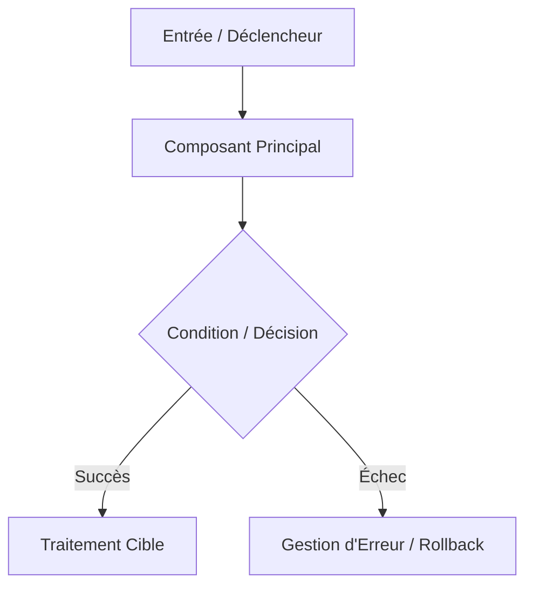

# Exploration Technique & Cadrage : <LOT-XX> (<Intitulé du Sujet de Cadrage>)

<!-- 
NOMENCLATURE DU FICHIER :
docs/analyses/cadrage/YYYY-MM-DD_cadrage-lot<XX>-<nom-du-lot-kebab-case>.md
Exemple : docs/analyses/cadrage/2026-10-25_cadrage-lot36-postgres-upsert-merge-and-staging.md
-->

- **Date :** YYYY-MM-DD
- **Auteur :** Antigravity / Pair Programming
- **Item Backlog :** [`docs/build/backlog/ITEM-XXX_<item-kebab-case>.md`](../../build/backlog/ITEM-XXX_<item-kebab-case>.md)
- **Document Source :** [`docs/roadmap/post-2.0-scope-review.md`](../../roadmap/post-2.0-scope-review.md)
- **LOT Cible :** LOT-XX (vX.Y.Z)
- **Statut :** <!-- PROPOSÉ / EN_REVUE / VALIDÉ -->
- **Documents aval :**
  - Analyse d'architecture : [`docs/analyses/YYYY-MM-DD_<nom>-analysis.md`](../)
  - Plan de réalisation : [`docs/build/plans/YYYY-MM-DD_plan-<nom>.md`](../../build/plans/)
  - Tâche opérationnelle : [`docs/build/tasks/TASK-LOTXX-01_<nom>.md`](../../build/tasks/)

---

## 1. Contexte & Problématique Actuelle

<!-- 
Présenter le constat initial terrain, les limitations actuelles en production, et les besoins métiers adressés.
-->

Dans PyIngestKit V2, le contexte actuel est le suivant :
- ...

### Limites constatées en production :
1. **Limite 1 :** ...
2. **Limite 2 :** ...
3. **Limite 3 :** ...

---

## 2. Architecture Cible Proposée

<!-- 
RÈGLE D'OR : Pour chaque diagramme Mermaid, inclure OBLIGATOIREMENT 
son équivalent textuel/ASCII juste en dessous pour assurer la lisibilité terminal.
-->



```text
┌──────────────────────────┐
│   Entrée / Déclencheur   │
└────────────┬─────────────┘
             │
             ▼
┌──────────────────────────┐
│   Composant Principal    │
└────────────┬─────────────┘
             │
             ▼
┌──────────────────────────┐
│   Condition / Décision   │
└──────┬────────────┬──────┘
       │            │
       │ Succès     │ Échec
       ▼            ▼
┌──────────────┐ ┌──────────────────────────┐
│  Traitement  │ │ Gestion d'Erreur /       │
│  Cible       │ │ Rollback Automatique     │
└──────────────┘ └──────────────────────────┘
```

### A. Évolution du Domaine Métier
- **Modèles & Énumérations :** ...
- **Contrats & Validation :** ...

### B. Évolution des Ports & Adaptateurs
- **Composants d'infrastructure :** ...
- **Mécanismes techniques (ex: Staging, Streaming, CAS) :** ...

### C. Traçabilité, Audit & Idempotence
- **Structures de persistance ou tables techniques :** ...
- **Garanties d'idempotence :** ...

---

## 3. Garde-fous & Invariants d'Architecture

<!-- 
Rappeler les invariants non négociables du projet.
-->

1. **Découplage Hexagonal Strict :**
   - Le domaine (`src/pyingestkit/domain/`) et les ports (`src/pyingestkit/ports/`) restent 100 % purs et indépendants de tout framework ou driver externe.
2. **Neutralité de l'API Publique Racine :**
   - Le point d'entrée `src/pyingestkit/__init__.py` reste rigoureusement gelé à ses 11 symboles historiques.
   - Les namespaces publics de haut niveau conservent une stricte neutralité vis-à-vis des fournisseurs cloud/SGBD.
3. **Transactionnalité & Robustesse :**
   - Atomicité absolue des opérations d'écriture (rollback complet en cas d'erreur sans état partiel ou corrompu).

---

## 4. Découpage du Lot Prévu

| Phase | Livrable | Fichiers Impactés |
| :--- | :--- | :--- |
| **1. Cadrage & Validation** | Note de cadrage validée | `docs/analyses/cadrage/` |
| **2. Analyse & Plan** | Analyse d'architecture & Plan de lot | `docs/analyses/` & `docs/build/plans/` |
| **3. Tâche & Backlog** | Activation de la tâche et sync TODOS | `docs/build/tasks/` & `TODOS.md` |
| **4. Domaine & Ports** | Modèles immuables et interfaces | `src/pyingestkit/domain/`, `ports/` |
| **5. Adaptateurs & Infra** | Implémentations concrètes | `src/pyingestkit/adapters/` |
| **6. Validation & Tests** | Tests unitaires, conformité, intégration | `tests/unit/`, `tests/integration/` |
| **7. Clôture** | REX, revue formelle, PR et merge | `docs/build/feedback/`, `docs/build/reviews/` |

---

## 5. Points de Cadrage & Décisions Retenues

<!-- 
Lister ici chaque question d'arbitrage soumise à la validation de l'utilisateur / pair,
en détaillant les différentes options étudiées (Option A, Option B, etc.) 
puis la décision finale retenue et motivée.
-->

1. **Question d'arbitrage 1 :** ...
   - *Question :* ...
   - *Options étudiées :*
     - **Option A (Recommandée) :** ...
     - **Option B :** ...
   - *Décision retenue :* **Option A.** ...

2. **Question d'arbitrage 2 :** ...
   - *Question :* ...
   - *Options étudiées :*
     - **Option A (Recommandée) :** ...
     - **Option B :** ...
   - *Décision retenue :* **Option A.** ...

