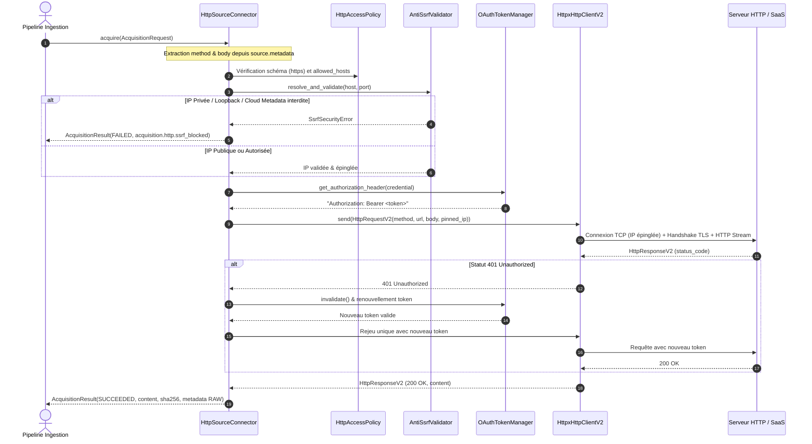

# Plan d'Implémentation : Acquisition HTTP Avancée, Rafraîchissement OAuth & Durcissement SSRF — LOT-37

- **Projet :** PyIngestKit
- **Statut :** READY
- **Date :** 2026-10-25
- **Auteur :** Antigravity / Pair Programming
- **Item Backlog :** [`docs/build/backlog/ITEM-007_advanced-http-acquisition-and-ssrf-hardening.md`](../backlog/ITEM-007_advanced-http-acquisition-and-ssrf-hardening.md)
- **Document source :** [`docs/analyses/2026-10-25_advanced-http-acquisition-and-ssrf-hardening-analysis.md`](../../analyses/2026-10-25_advanced-http-acquisition-and-ssrf-hardening-analysis.md)
- **Cadrage préalable :** [`docs/analyses/cadrage/2026-10-25_cadrage-lot37-advanced-http-acquisition-and-ssrf-hardening.md`](../../analyses/cadrage/2026-10-25_cadrage-lot37-advanced-http-acquisition-and-ssrf-hardening.md)
- **Branche cible :** `feat/http-ssrf-hardening-and-oauth`

---

## 1. Objectifs & Périmètre

Ce plan d'implémentation structure la livraison du jalon **LOT-37** (v2.3.0) pour doter PyIngestKit V2 de capacités industrielles de sécurité réseau anti-SSRF, de support des requêtes complexes avec payload (`POST`, `PUT`), de gestion autonome du cycle de vie des jetons OAuth 2.0, et d'un retry résilient avec gigue (*jitter*) et qualification de l'incertitude réseau :

### Capacités Livrées
1. **Bouclier Anti-SSRF & Immunité au DNS Rebinding (`src/pyingestkit/adapters/http/_ssrf.py`)** :
   - Validation stricte de chaque adresse IP résolue (IPv4 et IPv6) contre les plages loopback (`127.0.0.0/8`, `::1`), link-local / metadata (`169.254.0.0/16`, `169.254.169.254`, `fe80::/10`), multicast, et plages privées RFC 1918 (`10.0.0.0/8`, `172.16.0.0/12`, `192.168.0.0/16`).
   - Exemption contrôlée et auditable pour les intranets d'entreprise via `allow_private_networks: bool = False` et `allowed_ip_ranges: tuple[str, ...] = ()`.
   - Épinglage d'IP au niveau socket TCP pour éliminer le vecteur d'attaque de type Time-of-Check to Time-of-Use (DNS Rebinding).
2. **Support des Méthodes Écriture / Requête à Corps (`POST`, `PUT`, `HEAD`)** :
   - Évolution de `HttpRequestV2` avec `method: str = "GET"` et `body: bytes = b""`.
   - Extraction non-invasive depuis les métadonnées de source/requête (`source.metadata`) pour ne pas altérer le contrat de domaine universel `AcquisitionRequest`.
3. **Fournisseur de Jetons OAuth 2.0 & Auto-Refresh (`src/pyingestkit/adapters/http/oauth.py`)** :
   - Support natif des flux **Client Credentials Grant** et **Refresh Token Grant**.
   - Cache thread-safe en mémoire avec marge de sécurité (*clock skew* de 60s).
   - Détection des `401 Unauthorized`, invalidation de cache, renouvellement transparent auprès du serveur d'autorisation et rejeu unique.
   - Redaction intégrale et garantie de non-divulgation des secrets (`client_secret`, `access_token`, `refresh_token`).
4. **Retry Exponentiel avec Jitter & Incertitude Réseau (`OutcomeUncertainty`)** :
   - Algorithme Full Jitter pour prévenir les congestions de requêtes (*thundering herd*).
   - Prise en compte du header `Retry-After`.
   - Qualification sémantique : `OutcomeUncertainty.UNCERTAIN` lors d'un timeout sur requête avec mutation (`POST`, `PUT`) et `OutcomeUncertainty.KNOWN` sur lecture idempotente (`GET`, `HEAD`).

### Hors Périmètre (Exclusions Délibérées)
- Pas de modification de l'API racine gelée (`src/pyingestkit/__init__.py`) : reste à 11 symboles.
- Pas de dépendance obligatoire à HTTPX ou à des modules cryptographiques lourds : le coeur de validation IP repose exclusivement sur la bibliothèque standard Python (`ipaddress`, `socket`, `urllib.parse`).

---

## 2. Diagrammes d'Architecture & Flux de Données



```text
┌────────────────────────────────────────────────────────────────────────────────────────┐
│               FLUX COMPLET D'ACQUISITION HTTP DURCIE & GESTION OAUTH                   │
│                                                                                        │
│ 1. Ingestion Pipeline                                                                  │
│    │  AcquisitionRequest (url="https://api.saas.com/search",                          │
│    │                      metadata=(("http_method", "POST"), ("http_payload", "..."))) │
│    ▼                                                                                   │
│ 2. HttpSourceConnector                                                                 │
│    │  Validation Politique : Schéma HTTPS + Nom d'hôte dans allowed_hosts             │
│    ▼                                                                                   │
│ 3. AntiSsrfValidator (Résolution & Filtrage Zero-Trust)                               │
│    ├── DNS Resolution : socket.getaddrinfo("api.saas.com", 443)                       │
│    ├── Inspection IP : Rejet Loopback, RFC 1918, Link-Local (169.254.169.254)         │
│    └── Si rejet : Retour FAILED (acquisition.http.ssrf_blocked, NON_RETRYABLE)        │
│    └── Si succès : Élection de l'IP validée pour épinglage socket                      │
│    ▼                                                                                   │
│ 4. OAuthTokenManager                                                                   │
│    ├── Consultation cache mémoire (TTL avec marge de sécurité de 60s)                 │
│    └── Obtention du jeton Bearer (appel token_url si expiré ou absent)                 │
│    ▼                                                                                   │
│ 5. HttpxHttpClientV2 (avec SsrfSafeNetworkBackend)                                    │
│    ├── Connexion TCP directe sur l'IP épinglée (Immunité absolue DNS Rebinding)       │
│    ├── Handshake TLS avec server_hostname="api.saas.com" (Validation Certificat X.509)│
│    ├── Émission de la requête POST et du payload streamé                               │
│    └── Consommation bornée de la réponse (contrôle max_bytes)                          │
│    ▼                                                                                   │
│ 6. Réponse & Résilience                                                                │
│    ├── Si 401 : Invalidation cache OAuth, nouveau token, rejeu transparent unique      │
│    ├── Si 429/5xx : Retry avec Full Jitter (respect du header Retry-After)            │
│    ├── Si Timeout sur POST : FailureEvidence avec OutcomeUncertainty.UNCERTAIN         │
│    └── Si 200 OK : AcquisitionResult SUCCEEDED avec empreinte SHA-256 et preuves RAW  │
└────────────────────────────────────────────────────────────────────────────────────────┘
```

---

## 3. Cartographie des Fichiers & Dépendances

| Fichier | Action | Rôle & Responsabilité |
| :--- | :--- | :--- |
| `src/pyingestkit/adapters/http/_ssrf.py` | **Création** | Validateur d'adresses IP stdlib, détection des plages réservées, exceptions SSRF |
| `src/pyingestkit/adapters/http/oauth.py` | **Création** | Modèles `OAuthToken`, interfaces providers, implémentations client_credentials & refresh_token, `OAuthTokenManager` thread-safe |
| `src/pyingestkit/adapters/http/transport.py` | **Modification** | Ajout de `method`, `body`, `pinned_ip` dans `HttpRequestV2` |
| `src/pyingestkit/adapters/http/_httpx.py` | **Modification** | Intégration du `SsrfSafeNetworkBackend` pour épinglage socket, support streaming pour `POST`/`PUT` |
| `src/pyingestkit/adapters/http/source.py` | **Modification** | Évolution de `HttpAccessPolicy` (private networks, jitter), extraction non-invasive des options HTTP, interception 401, qualification de l'incertitude |
| `tests/unit/v2/test_http_ssrf.py` | **Création** | Tests unitaires exhaustifs du bouclier anti-SSRF (loopback, private, metadata, IPv6, exemptions) |
| `tests/unit/v2/test_http_oauth.py` | **Création** | Tests unitaires du gestionnaire OAuth 2.0 (cache, expiration, refresh transparent, redaction des secrets) |
| `tests/unit/v2/test_http_transport_v2.py` | **Création** | Tests unitaires des méthodes HTTP, payloads, timeouts et qualification d'incertitude |
| `docs/guides/http-acquisition-and-ssrf-hardening.md` | **Création** | Guide utilisateur complet pour l'acquisition HTTP sécurisée |
| `mkdocs.yml` | **Modification** | Déclaration du nouveau guide dans la navigation |
| `docs/build/tasks/TASK-LOT37-01_advanced-http-acquisition-and-ssrf-hardening.md` | **Création** | Fiche de tâche opérationnelle |
| `docs/build/tasks/TODOS.md` | **Modification** | Enregistrement de la tâche et suivi d'avancement |

---

## 4. Découpage en Étapes d'Implémentation

### Étape 1 : Création du Bouclier Anti-SSRF (`_ssrf.py`)
- Définition de l'exception `SsrfSecurityError(HttpTransportErrorV2)`.
- Énumération et matrices d'adresses réseau interdites (IPv4 et IPv6) via `ipaddress.ip_network`.
- Implémentation de `validate_ip_address(ip, allow_private=False, allowed_ranges=())`.
- Implémentation de `resolve_and_validate_host(host, port, allow_private=False, allowed_ranges=())` via `socket.getaddrinfo`.

### Étape 2 : Évolution des Contrats de Transport (`transport.py`)
- Extension de `HttpRequestV2` avec validation stricte :
  - `method: str = "GET"` parmi `("GET", "POST", "PUT", "HEAD")`.
  - `body: bytes = b""` avec vérification de type `bytes`.
  - `pinned_ip: str | None = None` pour l'injection directe d'adresse IP au transport.
- Extension de `HttpAccessPolicy` :
  - `allow_private_networks: bool = False`.
  - `allowed_ip_ranges: tuple[str, ...] = ()`.
  - `retry_jitter: bool = True`.
  - `max_backoff_seconds: float = 30.0`.

### Étape 3 : Module de Cycle de Vie des Jetons OAuth 2.0 (`oauth.py`)
- Implémentation de `OAuthToken` avec méthode `is_expired(clock_skew_seconds=60.0)`.
- Implémentation de la redaction stricte dans `__repr__` et `__str__`.
- Définition du protocole `OAuthTokenProvider`.
- Implémentation de `ClientCredentialsOAuthProvider` et `RefreshTokenOAuthProvider`.
- Implémentation de `OAuthTokenManager` thread-safe (`threading.Lock`) avec cache mémoire, détection d'expiration et méthode `invalidate()`.

### Étape 4 : Durcissement du Transport HTTPX (`_httpx.py`)
- Implémentation conditionnelle de `SsrfSafeNetworkBackend` (si `httpcore` est présent).
- Surcharge de `connect_tcp` pour forcer la connexion socket sur l'adresse IP épinglée tout en conservant `server_hostname` pour `start_tls`.
- Prise en charge des requêtes `POST`, `PUT`, `HEAD` avec corps de requête (`content=request.body`).

### Étape 5 : Intégration dans `HttpSourceConnector` (`source.py`)
- Extraction des métadonnées `http_method` et `http_payload` depuis `request.source.metadata`.
- Résolution pré-vol DNS et validation anti-SSRF sur l'URL cible et sur chaque redirection `Location`.
- Intégration du gestionnaire de jetons OAuth avec interception de réponse `401 Unauthorized` et rejeu unique.
- Calcul du délai de backoff avec algorithme Full Jitter (`random.uniform`).
- Positionnement d'`OutcomeUncertainty.UNCERTAIN` sur timeout ou erreur transport lors d'une méthode `POST` ou `PUT`.

### Étape 6 : Rédaction des Suites de Tests
- `tests/unit/v2/test_http_ssrf.py` : Validation exhaustive des blocages IP et cas d'exemption.
- `tests/unit/v2/test_http_oauth.py` : Validation du cache, de l'auto-renouvellement et du masquage des secrets.
- `tests/unit/v2/test_http_transport_v2.py` : Validation des verbes HTTP, des payloads, et de l'incertitude.

### Étape 7 : Documentation & Guide Opérationnel
- Rédiger `docs/guides/http-acquisition-and-ssrf-hardening.md`.
- Mettre à jour `mkdocs.yml`.

### Étape 8 : Qualification & Clôture
- `make quality`, `make architecture-v2`, `make test-v2`, `mkdocs build --strict`.
- Rédiger la fiche REX `FEEDBACK-LOT37-01` et la revue formelle de clôture de jalon.

---

## 5. Invariants & Critères d'Acceptation (DoD)

1. **Isolation Hexagonale :** 0 dépendance vers HTTPX ou sockets dans le domaine ou les ports.
2. **API Publique Gelée :** `src/pyingestkit/__init__.py` reste rigoureusement à 11 symboles.
3. **Sécurité Absolue :** Zéro secret (token, mot de passe, clé d'API) n'apparaît dans les diagnostics, logs ou exceptions.
4. **Couverture Qualité :** Batterie de tests 100% verte, 0 warning Ruff / Mypy strict, build MkDocs strict sans erreur.
