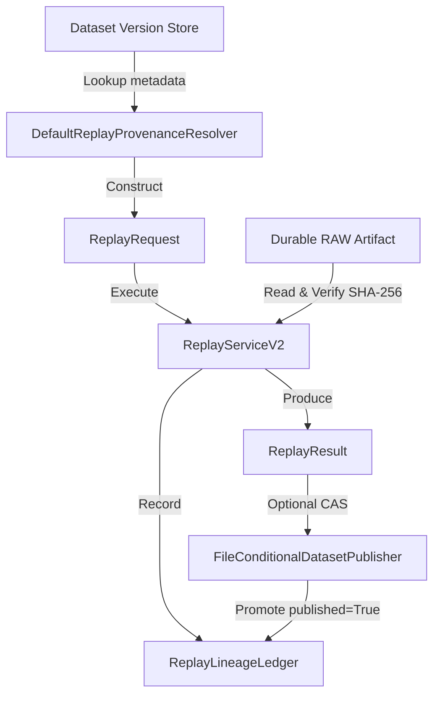

# Historical Replay & Provenance Reconstruction

PyIngestKit V2 provides **deterministic, historical replay and reconstruction** directly from durable RAW artifacts and version metadata. Unlike live retries or blind re-acquisition, V2 provenance replay guarantees that historical datasets can be reconstructed and audited with mathematical integrity and immutable causal lineage.

---

## 1. Core Principles & Problem Statement

In enterprise data engineering, recreating a dataset from months or years ago is frequently corrupted by three common failure modes:
1. **Live Source Drift**: The source API or database endpoint has evolved, mutated, or deleted historical records.
2. **Ambiguous Lineage**: The exact parameters, decoding pipeline, and raw bytes used during the historical run were not recorded immutably.
3. **Run ID Pollution**: Rerunning a pipeline overwrites or reuses historical execution identifiers, corrupting audit trails.

PyIngestKit solves this through **strict provenance replay**:
- **Zero Live Acquisition**: Historical RAW bytes are read strictly from durable artifact storage (`FileArtifactStore` or `S3ArtifactStoreV2`). Replay will fail with `ArtifactIntegrityError` before ever contacting a live upstream service.
- **Strict New Identity**: Every replay run allocates a distinct, globally unique `IngestionRunId`. Reusing the source run ID is rejected by invariant validation.
- **Bi-directional Lineage**: The framework records an immutable `ReplayLineage` mapping `source_run_id <-> replay_run_id`, recording SHA-256 digests, match outcomes, and publication timestamps.
- **Governed CAS Publication**: Once replayed and verified, new dataset versions can be promoted using atomic Compare-And-Swap (CAS) publication.

---

## 2. Architecture & Components



```text
┌──────────────────────────┐
│  Dataset Version Store   │
└────────────┬─────────────┘
             │ Lookup metadata
             ▼
┌──────────────────────────────────────┐
│   DefaultReplayProvenanceResolver    │
└──────────────────┬───────────────────┘
                   │ Construct
                   ▼
       ┌────────────────────────┐
       │     ReplayRequest      │
       └───────────┬────────────┘
                   │ Execute
                   ▼
┌──────────────────────────┐        ┌──────────────────────────┐
│   Durable RAW Artifact   │───────>│     ReplayServiceV2      │
│  (Read & Verify SHA-256) │        └────────────┬─────────────┘
└──────────────────────────┘                     │
                   ┌─────────────────────────────┴─────────────────────────────┐
                   │ Produce                                                   │ Record
                   ▼                                                           ▼
       ┌────────────────────────┐                                  ┌───────────────────────┐
       │      ReplayResult      │                                  │  ReplayLineageLedger  │
       └───────────┬────────────┘                                  └───────────▲───────────┘
                   │ (Optional CAS)                                            │
                   ▼                                                           │ Promote published=True
┌──────────────────────────────────────┐                                       │
│   FileConditionalDatasetPublisher    │───────────────────────────────────────┘
└──────────────────────────────────────┘
```

### Domain Models (`pyingestkit.domain.replay`)
- `ReplayLineage`: Immutable causal lineage record with `lineage_id`, `source_run_id`, `replay_run_id`, `dataset_id`, `version_id`, checksum verification, and `published` boolean status.
- `ReplayRequest`: Framework value describing the historical target, reconstructed definition, and expected dataset version.
- `ReplayResult`: Complete execution result containing the new run ID, integrity check outcome, and `ReplayLineage`.

### Ports & Protocols (`pyingestkit.ports.replay`)
- `ReplayProvenanceResolver`: Protocol for resolving historical evidence into executable requests (`resolve_from_version`, `resolve_from_run`).
- `ReplayLineageLedger`: Storage protocol for recording and listing replay lineages (`record_replay_lineage`, `list_replays`).

---

## 3. CLI Usage (`pik replay` / `pyingest replay`)

The `pik replay` CLI supports modern V2 dataset replay while preserving 100% backward compatibility with V1 run-based workflows.

### Replay a Specific Dataset Version

Replay the exact historical RAW bytes that produced a specific dataset version:

```bash
pik replay --dataset orders --version sha256-7f034c6b5e843a3e90f11b3fcb44d7b4a9ca3f5e14c9bf46ecd11fb66e17754c
```

Or using short flags:

```bash
pik replay -d orders -v sha256-7f034c6b5e843a3e90f11b3fcb44d7b4a9ca3f5e14c9bf46ecd11fb66e17754c
```

### Replay and Publish with Compare-And-Swap (CAS)

To automatically promote the replayed version to the current published pointer using CAS governance:

```bash
pik replay -d orders -v sha256-7f034c6b5e843a3e90f11b3fcb44d7b4a9ca3f5e14c9bf46ecd11fb66e17754c --publish
```

Terminal output:
```text
╭────────────────── Replay Provenance Execution ──────────────────╮
│ Dataset:         orders                                         │
│ Target Version:  sha256-7f034c6b5e843a3e90f11b3fcb44d7b4a9ca... │
│ Source Run ID:   d2137390-cb2e-4194-81d6-60e9fb29fd0c          │
│ Replay Run ID:   90a2cc59-604a-43ec-8a74-f29b659c348f          │
│ RAW Integrity:   MATCHED                                        │
│ Lineage ID:      c33a071884304b2ebacc7e4b42518170              │
│ CAS Publication: SUCCEEDED (rev: rev-4bb4a4bb5cdb46cd8f0675ba)  │
╰─────────────────────────────────────────────────────────────────╯
```

### Automation & CI/CD with JSON Output

Passing `--json` emits structured, machine-parsable JSON:

```bash
pik replay -d orders -v sha256-7f034c6b... --publish --json
```

```json
{
  "dataset_id": "orders",
  "lineage_id": "c33a071884304b2ebacc7e4b42518170",
  "matched": true,
  "origin_raw_checksum": "d1efbdbd801abb6872ab799a86e51b10e209d0020be968cffca5de4d2597d112",
  "publication_operation_id": "7c94f971-473c-45c6-a547-ac0a595ba639",
  "publication_status": "succeeded",
  "published": true,
  "replay_raw_checksum": "d1efbdbd801abb6872ab799a86e51b10e209d0020be968cffca5de4d2597d112",
  "replay_run_id": "90a2cc59-604a-43ec-8a74-f29b659c348f",
  "revision": "rev-4bb4a4bb5cdb46cd8f0675ba937b08d8",
  "source_run_id": "d2137390-cb2e-4194-81d6-60e9fb29fd0c",
  "succeeded": true,
  "version_id": "sha256-7f034c6b5e843a3e90f11b3fcb44d7b4a9ca3f5e14c9bf46ecd11fb66e17754c"
}
```

---

## 4. Programmatic Python API

For embedded platform integration, use `DefaultReplayProvenanceResolver` and `ReplayServiceV2` directly:

```python
from pyingestkit.adapters.filesystem import FileArtifactStore, FileDatasetVersionStore
from pyingestkit.adapters.memory import MemoryPublicationLedger
from pyingestkit.application.replay import ReplayServiceV2
from pyingestkit.application.resolver import DefaultReplayProvenanceResolver
from pyingestkit.application.runtime import IngestionRuntime
from pyingestkit.application.decoders import DecoderRegistry
from pyingestkit.adapters.formats.json import JsonDecoder
from pyingestkit.application.sources import SourceRegistry

# 1. Initialize storage and ledger
artifact_store = FileArtifactStore(root="/var/data/ingest")
version_store = FileDatasetVersionStore(root="/var/data/ingest")
ledger = MemoryPublicationLedger()

# 2. Setup runtime & replay service
decoders = DecoderRegistry()
decoders.register(JsonDecoder())
runtime = IngestionRuntime(
    sources=SourceRegistry(),
    decoders=decoders,
    artifacts=artifact_store,
    versions=version_store,
    publisher=version_store,
)
service = ReplayServiceV2(runtime=runtime, ledger=ledger)

# 3. Resolve provenance from historical version
resolver = DefaultReplayProvenanceResolver(
    version_store=version_store,
    artifact_store=artifact_store,
)
request = resolver.resolve_from_version(
    dataset_id="orders",
    version_id="sha256-7f034c6b5e843a3e90f11b3fcb44d7b4a9ca3f5e14c9bf46ecd11fb66e17754c",
)

# 4. Execute replay
result = service.replay(request)
assert result.succeeded
assert result.matched

print(f"Replay run: {result.replay_run_id}")
print(f"Lineage ID: {result.lineage.lineage_id}")
```
