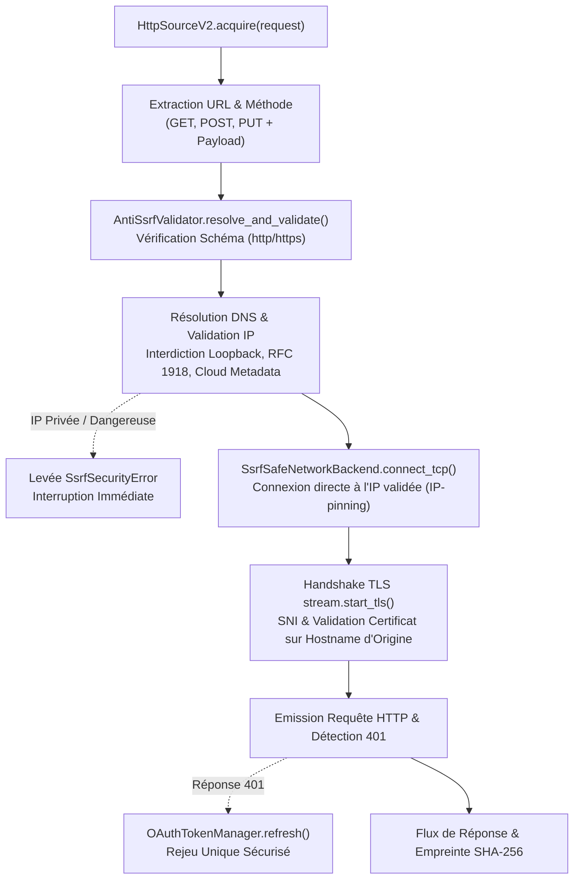

# Guide Pratique : Acquisition HTTP Avancée, Durcissement Anti-SSRF & OAuth 2.0

Ce guide détaille l'utilisation avancée de l'adaptateur source `HttpSourceV2` pour sécuriser vos flux d'ingestion d'API contre les attaques SSRF (Server-Side Request Forgery) et DNS Rebinding, exécuter des requêtes avec méthodes et charges utiles (`POST`/`PUT`), et gérer de façon transparente le cycle de vie des jetons d'authentification OAuth 2.0.

---

## 1. Vue d'Ensemble & Architecture de Sécurité Anti-SSRF

Dans un environnement Data Lakehouse, un connecteur d'ingestion HTTP est amené à consommer des API partenaires ou des webhooks dont les URL peuvent être paramétrées de manière dynamique. Sans protection active, le système est exposé aux vecteurs d'attaque SSRF :
1. **Pénétration d'infrastructures internes** : Réseau privé RFC 1918 (ex: `10.0.0.0/8`, `192.168.0.0/16`).
2. **Exfiltration d'identifiants de calcul cloud** : Endpoint de métadonnées d'instance (AWS/GCP/Azure link-local `169.254.169.254`).
3. **Contournement par DNS Rebinding (TOCTOU)** : Résolution initiale vers une IP publique valide, puis bascule vers `127.0.0.1` au moment de la connexion TCP.

Pour contrer ces risques au niveau transport, PyIngestKit applique un **ancrage d'adresse IP (IP-pinning)** combiné à un adaptateur réseau personnalisé au niveau de la couche socket :



```text
┌────────────────────────────────────────────────────────┐
│ HttpSourceV2.acquire(request)                          │
└───────────────────────────┬────────────────────────────┘
                            │
                            ▼
┌────────────────────────────────────────────────────────┐
│ Résolution & Validation : AntiSsrfValidator            │
│ - Vérification stricte du schéma (http / https)        │
│ - Résolution DNS vers adresse IP canonique             │
│ - Blocage : Loopback, Metadata (169.254), RFC 1918     │
└─────────────┬────────────────────────────┬─────────────┘
              │ (IP Rejetée)               │ (IP Publique Validée)
              ▼                            ▼
┌──────────────────────────┐ ┌──────────────────────────────────────────────┐
│ Levée SsrfSecurityError  │ │ SsrfSafeNetworkBackend.connect_tcp           │
│ Interruption immédiate,  │ │ Connexion socket directe sur IP validée      │
│ Pas de trafic réseau     │ │ (Immunité totale contre le DNS Rebinding)    │
└──────────────────────────┘ └──────────────────────┬───────────────────────┘
                                                    │
                                                    ▼
                             ┌──────────────────────────────────────────────┐
                             │ Handshake TLS stream.start_tls               │
                             │ Validation certificat et SNI sur le hostname │
                             └──────────────────────┬───────────────────────┘
                                                    │
                                                    ▼
                             ┌──────────────────────────────────────────────┐
                             │ Exécution Requête & Contrôle Statut HTTP     │
                             └──────────────┬───────────────────────────────┘
                                            │ (401 Unauthorized détecté)
                                            ▼
                             ┌──────────────────────────────────────────────┐
                             │ OAuthTokenManager : Invalidation & Refresh   │
                             │ Rejeu unique avec nouveau jeton d'accès      │
                             └──────────────────────────────────────────────┘
```

---

## 2. Configuration de la Politique d'Accès Anti-SSRF

Par défaut, l'adaptateur `HttpSourceV2` bloque toute communication vers les adresses IP privées, de bouclage, de métadonnées cloud et de multidiffusion.

### Politique Stricte par Défaut

```python
from pyingestkit.adapters.http import HttpAccessPolicy, HttpSourceV2

# Politique par défaut : seules les IP publiques sont autorisées
policy = HttpAccessPolicy()

source = HttpSourceV2(
    source_id="api.partner.inventory",
    access_policy=policy,
)
```

### Autorisation Contrôlée de Réseaux Internes

Pour des scénarios d'ingestion inter-services dans un VPC ou un environnement de test local, il est possible d'ajuster la politique de manière explicite :

```python
from pyingestkit.adapters.http import HttpAccessPolicy, HttpSourceV2

# Autorisation ciblée d'un sous-réseau interne sécurisé
policy = HttpAccessPolicy(
    allow_private_networks=False,
    allowed_ip_ranges=("10.150.0.0/16",), # Seule cette plage privée est débloquée
    allowed_schemes=("https",),          # Restriction au protocole HTTPS
)

source = HttpSourceV2(
    source_id="api.internal.erp",
    access_policy=policy,
)
```

---

## 3. Requêtes d'Acquisition avec Méthodes et Payloads (`POST`, `PUT`)

De nombreuses API modernes requièrent une méthode `POST` avec un corps JSON pour lancer des requêtes de recherche complexes ou paginées.

Les paramètres de la requête sont transmis de façon standardisée via le champ `metadata` de l'objet `Source` :

```python
import json
from pyingestkit.adapters.http import HttpSourceV2
from pyingestkit.domain.acquisition import AcquisitionRequestV2
from pyingestkit.domain.runtime import CorrelationContext
from pyingestkit.domain.shared import IngestionRunId
from pyingestkit.domain.sources import Source

# 1. Définition du corps de requête (Search Filter API)
search_payload = {
    "filter": {"updated_since": "2026-10-01T00:00:00Z", "status": "active"},
    "limit": 1000,
}

# 2. Configuration de la source avec méthode POST et Payload
source_def = Source.http(
    url="https://api.partner.example.com/v1/customers/query",
    metadata={
        "http_method": "POST",
        "http_payload": json.dumps(search_payload),
        "http_headers": {
            "Content-Type": "application/json",
            "Accept": "application/json",
        },
    },
)

# 3. Exécution de l'acquisition
run_id = IngestionRunId.new()
request = AcquisitionRequestV2(
    source=source_def,
    ingestion_run_id=run_id,
    correlation=CorrelationContext(ingestion_run_id=str(run_id)),
)

source_adapter = HttpSourceV2(source_id="api.partner.customers")
result = source_adapter.acquire(request)

if result.status.value == "succeeded":
    print(f"Acquisition réussie : {result.bytes_read} octets reçus (SHA-256: {result.fingerprint})")
```

---

## 4. Authentification & Rafraîchissement OAuth 2.0

Le module `pyingestkit.adapters.http.oauth` propose une gestion complète et thread-safe du cycle de vie des jetons OAuth 2.0, avec détection automatique des expirations et réémission transparente sur erreur 401.

### Flux Machine-to-Machine : `client_credentials`

```python
from pyingestkit.adapters.http import HttpSourceV2
from pyingestkit.adapters.http.oauth import (
    ClientCredentialsOAuthProvider,
    OAuthTokenManager,
)

# 1. Configuration du fournisseur OAuth Client Credentials
token_provider = ClientCredentialsOAuthProvider(
    token_url="https://auth.partner.example.com/oauth/token",
    client_id="ingest_service_prod",
    client_secret="s3cr3t_cl13nt_k3y",
    scope="datasets:read offline_access",
)

# 2. Initialisation du gestionnaire de jetons avec marge préemptive
token_manager = OAuthTokenManager(
    provider=token_provider,
    clock_skew_seconds=60, # Renouvelle le jeton 60 secondes avant l'expiration réelle
)

# 3. Association à l'adaptateur source
source = HttpSourceV2(
    source_id="api.partner.secured",
    token_manager=token_manager,
)
```

### Flux Utilisateur Délégué : `refresh_token`

```python
from pyingestkit.adapters.http import HttpSourceV2
from pyingestkit.adapters.http.oauth import (
    OAuthTokenManager,
    RefreshTokenOAuthProvider,
)

token_provider = RefreshTokenOAuthProvider(
    token_url="https://auth.cloud.example.com/oauth/v2/token",
    client_id="client_app_id",
    client_secret="client_secret_value",
    refresh_token="r3fr3sh_t0k3n_v4lu3",
)

token_manager = OAuthTokenManager(provider=token_provider)

source = HttpSourceV2(
    source_id="api.cloud.reporting",
    token_manager=token_manager,
)
```

### Mécanisme de Gestion des 401 & Masquage des Secrets
- **Rejeu Unique Sécurisé** : Lorsqu'un endpoint distant répond par un code HTTP `401 Unauthorized`, l'adaptateur invalide le cache mémoire du jeton, sollicite immédiatement un nouveau token via le provider, et rejoue la requête une unique fois. Si l'échec persiste, l'erreur est levée pour prévenir toute boucle infinie.
- **Masquage Strict des Secrets (Redaction)** : Les représentations `repr()` de `OAuthToken`, `ClientCredentialsOAuthProvider` et `RefreshTokenOAuthProvider` masquent systématiquement les jetons et secrets (`access_token="[REDACTED]"`, `client_secret="[REDACTED]"`), empêchant toute fuite dans les journaux d'audit ou les tracebacks.

---

## 5. Résilience Réseau, Full Jitter & Incertitude

Les appels HTTP réseau sont intrinsèquement sujets aux fluctuations de latence et aux déconnexions transitoires. PyIngestKit implémente une stratégie de robustesse avancée :

### Stratégie de Retry Full Jitter
Pour éviter l'effet "troupeau mugissant" (thundering herd) sur les services distants en cas de panne globale, les retentatives appliquent un délai aléatoire uniforme :
$$\text{Sleep} = \text{Uniform}(0, \min(\text{max\_backoff}, \text{base} \times 2^{\text{attempt}}))$$

### Traitement de l'Incertitude Réseau (`OutcomeUncertainty`)
- Pour une requête idempotente (`GET`), un timeout réseau donne lieu à une retentative sûre.
- Pour une requête à effet de bord (`POST`, `PUT`), si la connexion est interrompue après l'envoi des en-têtes sans accusé de réception, le statut de l'opération distante est inconnu.
- PyIngestKit qualifie cette situation avec `OutcomeUncertainty.REQUIRES_RECONCILIATION`, alertant le pipeline orchestrateur qu'une étape de vérification est indispensable avant toute réémission.

---

## 6. Bonnes Pratiques & Précautions Opérationnelles

> [!IMPORTANT]
> **Ne jamais désactiver globalement la politique anti-SSRF en production** : L'activation de `allow_private_networks=True` ne doit être réservée qu'aux environnements de développement local ou d'intégration continue isolée. Privilégiez systématiquement l'ajout explicite de plages d'IP ciblées via `allowed_ip_ranges`.

> [!TIP]
> **Utilisation conjointe avec des proxys d'entreprise** : Si vos requêtes doivent traverser un proxy HTTP sortant, veillez à ce que l'URL du proxy soit configurée au niveau de l'environnement (`HTTPS_PROXY`) et que la résolution DNS locale autorise l'accès à ce relais.
